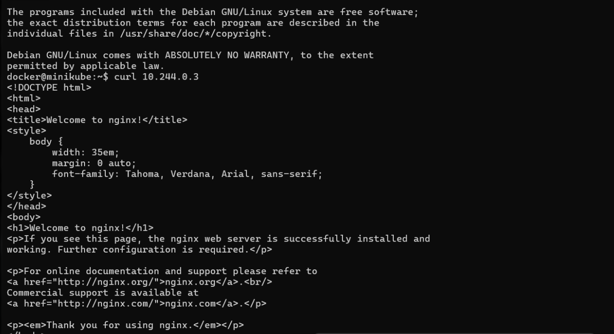

# My First Kubernetes Project – Deploying Nginx on Minikube

## Project Overview

This is my first hands-on Kubernetes project. I created and deployed an Nginx application using Minikube on Windows 11 with Docker Desktop.

## Technologies Used

- Kubernetes
- Minikube
- Docker Desktop
- Nginx
- kubectl
- Windows 11
- YAML

## What I Learned

- Setting up a local Kubernetes cluster using Minikube.
- Creating a Kubernetes Pod.
- Deploying an Nginx application.
- Checking Pod status using kubectl.
- Accessing a running application using its Pod IP.
- Connecting to the Minikube environment using SSH.

## Commands Used

```shell
minikube start
kubectl get nodes
kubectl create -f pod.yml
kubectl get pods
kubectl get pods -o wide
minikube ssh
curl <pod-ip>
```

Get the Pod IP from the `kubectl get pods -o wide` output and replace `<pod-ip>` in the curl command. Pod IPs can change when a Pod is recreated.

## Application Verification

The Nginx application was successfully deployed, and I verified that the Nginx welcome page was accessible from inside the Minikube environment.



## Project Goal

To gain practical experience with Kubernetes fundamentals, container orchestration, and application deployment.
